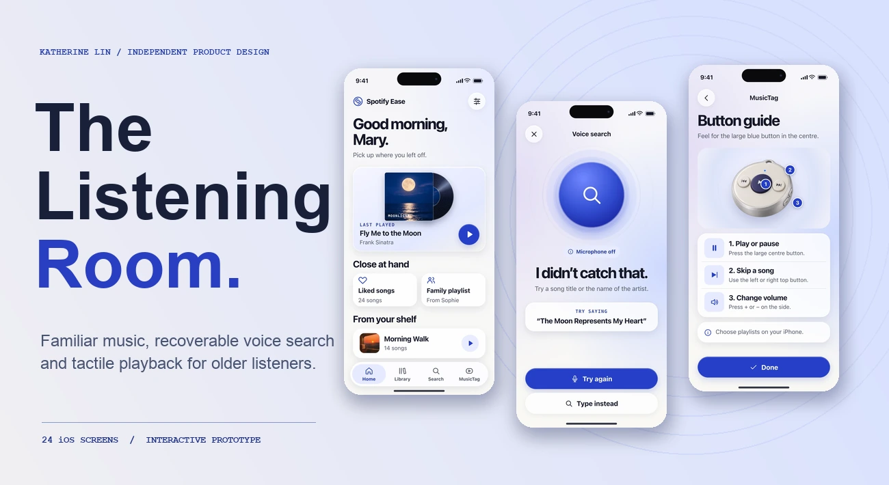

# The Listening Room

**Independent product design case study by Katherine Lin**

AI product experience · UX design · AI application product management

An accessible music experience for older listeners. Spotify Ease puts familiar songs within reach, voice search makes uncertainty visible, and MusicTag provides tactile controls for everyday playback.

[**Try the interactive prototype**](https://katherine0292.github.io/the-listening-room/prototype/) · [View the portfolio case study](https://katherine0292.github.io/the-listening-room/) · [Browse all 24 screens](https://katherine0292.github.io/the-listening-room/gallery/)

## The brief

Design a clearer path back to familiar music for listeners aged 65 and over who can lose their place when an interface changes, a control is hard to tap, or voice search misunderstands them. Help listeners recover without having to ask someone else to operate the phone.

I contributed desk research, two qualitative interviews, design rationale, experience-centred design writing and demo editing during the earlier exploration. For this independent portfolio edition, I developed the research synthesis, 24-screen interaction prototype, voice product specification and evaluation plan. Spotify supplies the design context. The deliverable is a browser-based concept.

## Evidence into decisions

| Research signal | Product decision | Where to see it |
|---|---|---|
| Familiar music is part of daily routines and carries personal memories. | Give recent playback, liked songs and family playlists predictable placements. | Home and Library |
| Changing layouts and small controls can interrupt listening. | Keep the navigation stable and pair primary playback icons with labels. | Library and Now Playing |
| Accent and exact-title mismatches can make voice search costly to retry. | Show when the microphone is active. Offer a result to review, a retry and an immediate typing path. | [Voice recovery](https://katherine0292.github.io/the-listening-room/prototype/?scenario=voice) |
| A shared song can invite conversation, but opening or forwarding links can be difficult. | Place family playlists in the library and make invitation access explicit. | [Family sharing](https://katherine0292.github.io/the-listening-room/prototype/?scenario=family) |
| Tactile controls can make everyday playback simpler. | Put playback and volume on MusicTag. Keep playlist selection and audio output on the phone. | [Early concept](https://katherine0292.github.io/the-listening-room/early-concept/) and the MusicTag button guide |

## Explore the prototypes

- [**High-fidelity interactive iOS prototype**](https://katherine0292.github.io/the-listening-room/prototype/) includes search, playback, preferences, invitations, audio output and two-step MusicTag pairing. Guided entries let reviewers start with a voice miss, offline search or pairing failure.
- [**Early interactive concept**](https://katherine0292.github.io/the-listening-room/early-concept/) reconstructs the original welcome, library and player flow with a screen-side MusicTag simulation. The archive shows the original interface and physical explorations.
- [**Screen gallery**](https://katherine0292.github.io/the-listening-room/gallery/) includes all 24 source screens and the [seven-page iOS design boards](assets/archive/listening-room-ios-design.pdf).

The high-fidelity demo uses a fixed catalogue and synthesised audio. Voice recognition, invitations, Bluetooth pairing and speaker routing are simulated. Buttons for voice and MusicTag demonstrate product behaviour using local state.

## Supporting evidence

| Document | What it covers |
|---|---|
| [Research synthesis](docs/research.md) | Two firsthand interviews, desk research, evidence strength, affinity themes and anonymised design personas |
| [Interview guide and fieldwork summary](docs/interview-guide.md) | Research script, prompts, aggregate themes and synthesis method |
| [Literature and product review](docs/literature-and-product-review.md) | English literature catalogue, market review and implications |
| [Design rationale and decisions](docs/design-rationale.md) | Concept evolution, scope, trade-offs and traceability to the 24 screens |
| [Voice product specification](docs/voice-product-spec.md) | Recognition, catalogue matching, consent, fallback, measurement and rollout |
| [Evaluation and reflection](docs/evaluation.md) | Formative findings from the early concept, browser verification and a proposed pilot for the newer design |

## Run locally

Open `index.html` with a browser from the repository root or serve the repository with `python3 -m http.server 8000`. No build step or account is required. The prototypes use local assets and the high-fidelity prototype stores demo preferences in the browser. Select **Restart prototype** to clear that state.

Portfolio concept by Katherine Lin. Product names identify the design context. Illustrative record sleeves and high-fidelity device art use generated imagery. Icon attribution appears in the [Lucide licence](assets/vendor/lucide-license.txt).
