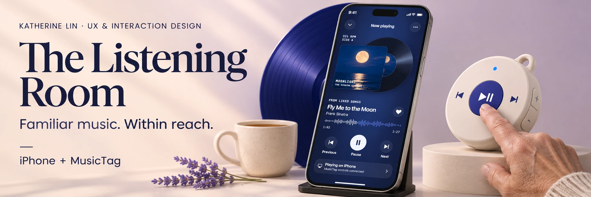
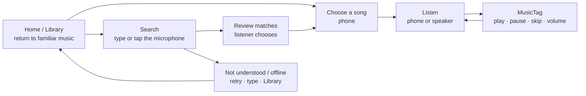
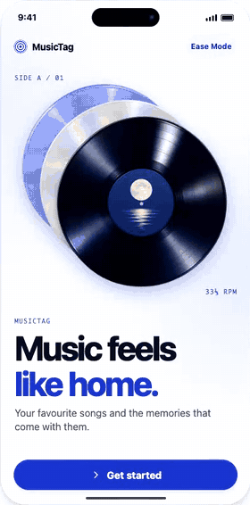
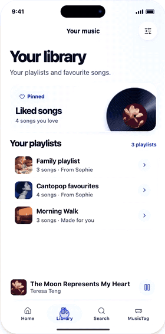
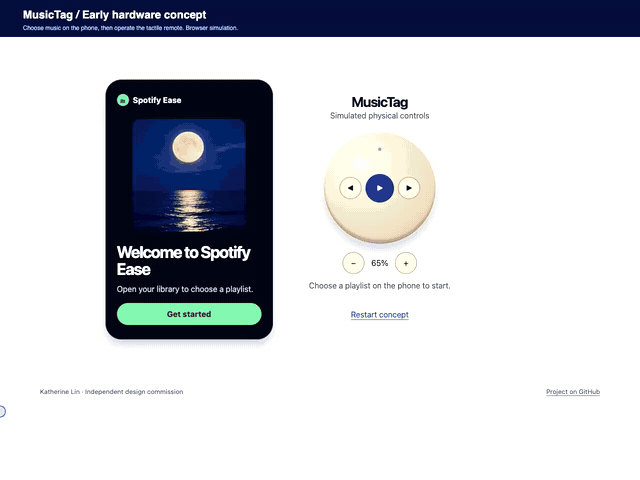

<div align="center">

# The Listening Room

**Familiar music. Within reach.**

A simplified iPhone experience and a tactile MusicTag remote, designed to help listeners aged 65+ return to songs they know and recover when search or setup goes wrong.

**Independent UX and interaction design commission · Katherine Lin**

[**Explore the portfolio — live app, sound and hardware interaction included**](https://katherine0292.github.io/MusicTag/)



</div>

## At a glance

| | |
| --- | --- |
| **Problem** | Familiar listening routines break when saved songs are difficult to recover, controls change, or voice search misunderstands a title. |
| **For** | Adults aged 65+ with different levels of digital confidence, vision, dexterity and language needs. |
| **Solution** | Choose music on the phone; control everyday playback with five tactile buttons; keep retry and typing within reach. |
| **My role** | Research, synthesis, interaction design, browser prototypes, voice interaction specification and evaluation planning. |
| **Evidence** | A 13-source literature catalogue, five-service comparison, two traceable firsthand interviews and an early walkthrough. Qualitative direction, not prevalence. |
| **Status** | Working browser prototypes and 24 iOS design states. New-prototype usability testing, live speech recognition and Bluetooth firmware remain future work. |

The project is named **The Listening Room**; **Spotify Ease** is its simplified phone concept; **MusicTag** is the tactile remote and the repository name. Spotify is the reference interaction context.

## The listening loop



The phone chooses content and audio output. MusicTag controls what is already playing; it does not contain a speaker.

## Features, in operation

These GIFs are excerpts of actual browser interactions. The portfolio contains the same prototypes, playable in place with synthesised sound, plus all feature videos. MP4 versions below retain sound and the complete actions; GIF previews have no audio.

### 1. Return to familiar music



Home keeps last played close. Library pins Liked songs. Labelled controls, a persistent mini-player and undo let listeners browse without losing their place.

[Watch this feature with sound](assets/recordings/01-listening.mp4)

### 2. Search and recover


Voice is optional. Listening is visible, results show title and artist, and no result starts playing until selected. A missed request leads to retry or typing; an offline screen keeps Library available. The demo uses fixed sample utterances, rather than microphone input or an AI model.

[Watch this feature with sound](assets/recordings/02-search-recovery.mp4)

### 3. A family playlist, with clear permissions



A named playlist gives music shared by family a stable home. The invitation states whether a guest can listen or add songs before it is sent. Invitations and links are local demonstrations.

[Watch this feature with sound](assets/recordings/03-family.mp4)

### 4. Make listening comfortable


Audio output is separate from the remote. Text size, motion and recognition-language preferences are adjustable. The voice-language setting demonstrates a proposed product choice; it does not enable a real multilingual recogniser.

[Watch this feature with sound](assets/recordings/04-preferences.mp4)

### 5. Set up MusicTag and learn by doing


Discovery and connection are separate steps. A failure explains the next action. The button guide allows practice with playback, skip and volume, instead of relying on an icon legend alone.

[Watch this feature with sound](assets/recordings/05-musictag-setup.mp4)

### 6. Early hardware concept: phone and remote together



The original three-screen study makes the division of work tangible: choose a playlist on the phone, then use the remote. The portfolio embeds this working study in the design-decision chapter. Its original interaction flow is retained, with synthesised audio added so play, pause and volume can also be heard.

[Complete early MusicTag operation video](assets/recordings/musictag-early-full.mp4) · [Early concept source](early-concept/)

This recording shows the repository’s **browser hardware simulation**, rather than footage of a physical Bluetooth device. No original device-operation video was found in the repository’s visible history.

## Complete walkthroughs

| Recording | Coverage |
| --- | --- |
| [Full app walkthrough](assets/recordings/app-full.mp4) · [English captions](assets/recordings/app-full.vtt) | Welcome, Library, listening, seek, save/undo, search, voice miss and retry, typing, offline recovery, family invitation, output, preferences, MusicTag pairing and controls. |
| [Full early MusicTag walkthrough](assets/recordings/musictag-early-full.mp4) · [English captions](assets/recordings/musictag-early-full.vtt) | Welcome, all three playlists, centre play/pause, previous/next, volume up/down and reset, with visible phone–remote feedback. |

Recordings capture real UI operations and the prototypes’ synthesised Web Audio output. They are not animations assembled from exported screens. Videos and GIFs are stored in the repository so README previews do not depend on an external video host.

## From evidence to decisions

| Observation | Design response | Evidence in the work |
| --- | --- | --- |
| Familiar songs accompany routines; losing access breaks the moment. | Stable Home and Library, last played and pinned favourites. | Choose-and-play demo and persistent mini-player. |
| Mis-taps and changed controls create doubt. | Labelled transport, undo, adjustable display and bounded hardware controls. | Playback, preferences and early MusicTag demos. |
| Accents and exact-title matching can make voice another barrier. | Visible listening, match review, retry and an equal typing path. | Search recovery demo and [voice specification](docs/voice-product-spec.md). |
| Listeners need to understand where to change a playlist. | Content stays on the phone; MusicTag handles five repeated actions. | Embedded phone–remote study and setup guide. |
| Shared songs can be hard to find again. | Family playlist is a named destination; invitations show access. | Family playlist demo. |

Two interviews and an early walkthrough support design hypotheses; they do not establish a measured improvement in independence or wellbeing. Personas are fictional composites. See the [research synthesis](docs/research.md) and [evaluation plan](docs/evaluation.md).

## AI interaction decisions

| Decision | Intended behaviour | Delivery status |
| --- | --- | --- |
| Start with consent | Tap the mic to start; show listening, stop and cancel. | Simulated listening interaction. No microphone capture. |
| Suggest, then let the listener choose | Show identifiable title and artist matches before playback. | Working fixed-catalogue result selection. |
| Make uncertainty recoverable | Retry, edit or type; keep Library accessible offline. | Working deterministic recovery scenarios. |
| Plan for language variation | Australian English, Cantonese and Mandarin; test mixed language, aliases and same-title songs. | Preference UI and product specification; model testing planned. |
| Minimise retained data | Proposed analytics record transitions and elapsed time, without raw audio or transcripts by default. | Specification, not a deployed analytics service. |

Eight voice states are **defined** in the specification; the browser demonstrates selected paths. Confidence thresholds, recognition quality and catalogue ranking need representative pilot data. No model was trained or evaluated for this project.

## How the concept evolved

| Stage | What changed | Reason |
| --- | --- | --- |
| Melody Box proposal | Dedicated player, presets, display, voice and dock. | Explored a familiar physical route into music. |
| Early Spotify Ease + MusicTag | Three-screen phone flow and a five-control remote. | Keep music choice on an existing device; reduce what the remote asks the listener to learn. |
| High-fidelity listening flow | 24 states, explicit output, preferences, sharing, pairing guide and failure paths. | Address button learning, playlist location and recovery questions from the early walkthrough. |
| Integrated portfolio | Two live demos, sound, native 3:1 cover, complete archive images and function-based recordings. | Let reviewers inspect the design and operate its evidence without leaving the case study. |

[Design rationale](docs/design-rationale.md) · [Chinese portfolio review and full improvement plan](docs/portfolio-review-zh.md)

## Evaluation and next steps

| Evidence | Status |
| --- | --- |
| Desk research, two interviews and early walkthrough | Completed; formative qualitative direction. |
| Browser flows, failure recovery, narrow widths and embedded demos | Verified with the recorded operations and browser checks in [review/](review/). |
| Usability sessions with listeners 65+ | Planned. Measure independent completion, wrong turns, time, recovery and help needed. |
| Physical remote ergonomics, actual Bluetooth and audio routing | Planned; browser simulation cannot establish tactile usability or firmware reliability. |
| Recognition and catalogue pilot across languages and accents | Planned; compare with a typed-search baseline. |

## My contribution

I led the research, synthesis, product interaction and prototype scope for the independent commission: the phone–remote split, stable navigation, shared playlists, accessible display preferences, error recovery, voice interaction requirements and the next evaluation plan. The project delivers design and browser demonstrations; production services, recognition models and remote firmware sit outside that scope.

## Repository and local preview

| Path | Contents |
| --- | --- |
| `index.html`, `site-src/`, `img/` | Bilingual portfolio and its editable source. |
| `prototype/` | High-fidelity app with synthesised audio and deterministic scenarios. |
| `early-concept/` | Early phone and MusicTag interaction study. |
| `assets/recordings/` | Full MP4s, five app feature clips, GIF previews, VTT captions and chapter manifests. |
| `assets/embed.js` | Embedded presentation, trusted height messages and offscreen audio pause. |
| `gallery/`, `assets/screens/`, `assets/archive/` | 24 screen exports, concept studies and design PDF. |
| `docs/` | [Documentation index](docs/README.md), brief, research, rationale, voice specification and evaluation. |
| `scripts/` | Recording and browser verification scripts. |

```bash
python3 -m http.server 8000
# Open http://localhost:8000/
```

Rebuild after editing portfolio source:

```bash
python3 site-src/build.py
```

No build dependencies are needed to view the project. Serve it over HTTP so the two same-origin embedded demos can exchange height and pause messages. **Restart prototype** clears saved demo preferences. Re-recording uses Playwright, Chrome and ffmpeg; see [recording notes](docs/recordings.md).

## Links and credits

The published project is now under `/MusicTag/`. Older `/the-listening-room/` Pages links return 404 following the repository-name change; internal documentation and media now use relative paths. See the [link audit](docs/link-audit.md).

Independent concept, not affiliated with or endorsed by Spotify. Audio is synthesised, not licensed song playback. Record sleeves, device visualisations and covers use generated imagery. [Cover generation brief](docs/cover-generation.md). Icons: [Lucide licence](assets/vendor/lucide-license.txt).
