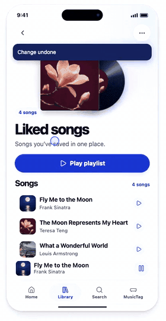
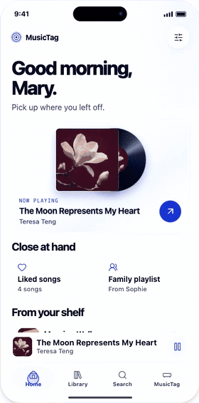
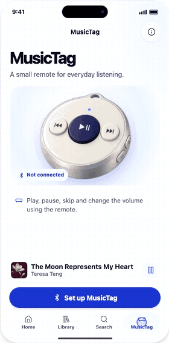
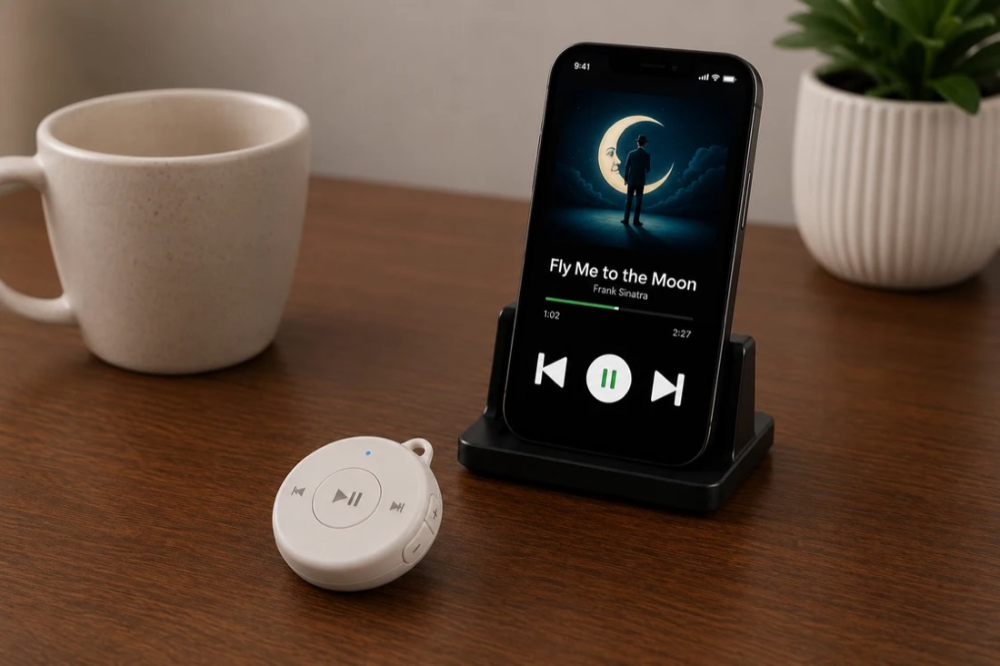

<div align="center">

# MusicTag

**Familiar music. Within reach.**

A music experience for listeners aged 65+: choose familiar songs on the phone, control playback with a tactile remote, and recover when search or setup goes wrong.

**Independent UX and interaction design commission · Katherine Lin**

[**Explore the MusicTag portfolio**](https://katherine0292.github.io/MusicTag/)


</div>

## At a glance

| | |
| --- | --- |
| **Problem** | Familiar listening routines break when saved songs are difficult to find, controls change, or voice search misunderstands a title. |
| **Audience** | Adults aged 65+ with varied digital confidence, vision, dexterity and language needs. |
| **Solution** | A simplified phone interface, five tactile playback controls, and search with clear recovery paths. |
| **My role** | Research, synthesis, interaction design, prototyping, voice interaction specification and evaluation planning. |
| **Evidence** | A 13-source literature catalogue, five-service comparison, two traceable firsthand interviews and an early walkthrough. |
| **Status** | Working browser prototype and 24 design states. Usability testing of the current design and production service integration are planned. |

## The experience

The phone chooses songs, playlists and audio output. The MusicTag remote handles play/pause, previous, next and volume. A persistent mini-player keeps listening within reach while the person browses.

<table>
<tr>
<td width="33%" valign="top" align="center">

<p><strong>Return to familiar music</strong></p>
<p>Last played, pinned favourites, labelled controls and undo.</p>
</td>
<td width="33%" valign="top" align="center">

<p><strong>Search and recover</strong></p>
<p>Review matches before playback. Retry, type or return to Library.</p>
</td>
<td width="33%" valign="top" align="center">

<p><strong>Share with family</strong></p>
<p>A stable playlist destination with clear guest permissions.</p>
</td>
</tr>
<tr>
<td width="33%" valign="top" align="center">

<p><strong>Make listening comfortable</strong></p>
<p>Separate speaker choice, adjustable text and motion, and language preferences.</p>
</td>
<td width="33%" valign="top" align="center">

<p><strong>Learn the remote by trying it</strong></p>
<p>Discovery, connection, failure recovery and a practical button guide.</p>
</td>
<td width="33%" valign="top" align="center">

<p><strong>Keep the phone and remote in sync</strong></p>
<p>Choose a playlist on the phone; use the remote for repeated playback actions.</p>
</td>
</tr>
</table>

The previews show actual browser operations. The portfolio includes the 24 screens, a compact phone–remote interaction study and one continuous recording of the complete phone workflow. Playback in the prototype uses synthesised sound. Voice input, Bluetooth pairing, invitations and speaker switching are local simulations.

## From evidence to decisions

Familiar songs accompany everyday routines. The research focused on the moments when navigation, a changed control or a misunderstood request interrupted those routines, and on how listeners tried to continue.

| Research observation | Design response |
| --- | --- |
| Saved songs are difficult to recover. | Predictable Home and Library destinations, recent playback and pinned favourites. |
| Small controls and unexpected changes create doubt. | Labelled transport controls, undo, adjustable display and five bounded remote actions. |
| Accent and exact-title matching can make voice another barrier. | Visible listening, distinguishable results, retry and an equal typing path. |
| Listeners need to know where to change playlists. | Content choice stays on the phone; the remote controls what is already playing. |
| Shared music can be hard to find again. | A named Family playlist with recipient permissions shown before inviting. |

The interviews and early walkthrough provide qualitative direction. They do not establish prevalence or a measured improvement in independence or wellbeing. The personas are fictional composites used to examine flows.

## Key interaction decisions

- **Keep the listener in control.** Voice search proposes identifiable title and artist matches; the listener chooses what plays.
- **Make failure recoverable.** A missed request leads to retry or typing. An offline search screen keeps Library available. Connection errors explain the next action.
- **Separate device responsibilities.** The phone selects music and the speaker. MusicTag handles everyday playback and does not contain a speaker.
- **Teach through practice.** The setup guide lets listeners try playback, skip and volume with visible feedback.
- **Plan for language variation.** The specification considers Australian English, Cantonese and Mandarin, including alternate titles and mixed-language requests. Recognition and catalogue quality need a representative pilot.

The prototype uses a fixed catalogue and sample voice inputs. It does not capture a microphone, train a recognition model or connect to a production music service. Eight voice states are defined in the specification; selected paths are demonstrated in the browser.

## How MusicTag evolved

| Stage | Design direction | Reason |
| --- | --- | --- |
| Dedicated player exploration | Presets, display, voice and a charging dock. | Explore a familiar physical route into music. |
| Phone and remote study | A three-screen phone flow and a five-control remote. | Use the phone listeners already own and reduce what a new device asks them to learn. |
| High-fidelity prototype | 24 states, output choice, preferences, sharing, connection guidance and recovery. | Address button learning, playlist location and failure handling. |
| Portfolio | Direct screen journeys, native phone–remote controls and a phone-only walkthrough. | Make the design evidence visible within one coherent case study. |

## Evaluation and next steps

Desk research, two interviews and an early walkthrough are complete. Browser verification covers navigation, playback, search, invitations, preferences, connection recovery, remote controls and narrow screen widths.

The next usability round will ask listeners aged 65+ to find a saved song, recover from a missed voice request, choose a speaker, pair MusicTag and skip without looking at the phone. Measures include independent completion, time, wrong turns and help needed. Physical ergonomics and actual Bluetooth reliability require a real-device study. Recognition testing will compare language and accent conditions with a typed-search baseline.

## My contribution

I led the independent commission's research, synthesis, interaction design and prototype scope. My work includes the phone–remote split, stable navigation, shared playlists, display preferences, recoverable voice interaction, practical setup guidance and the evaluation plan.

The deliverables are the bilingual portfolio, browser prototypes, 24 design states, research synthesis, design rationale, voice interaction requirements and evaluation documentation. Production catalogue services, invitation infrastructure and Bluetooth firmware sit outside this delivery.

## Run locally

```bash
python3 -m http.server 8000
```

Open localhost on port 8000. Rebuild the portfolio after source changes with:

```bash
python3 site-src/build.py
```

The project uses local browser assets and requires no build dependencies for viewing. The prototype's Restart action restores demo preferences. Icon licence information is included in the repository.
