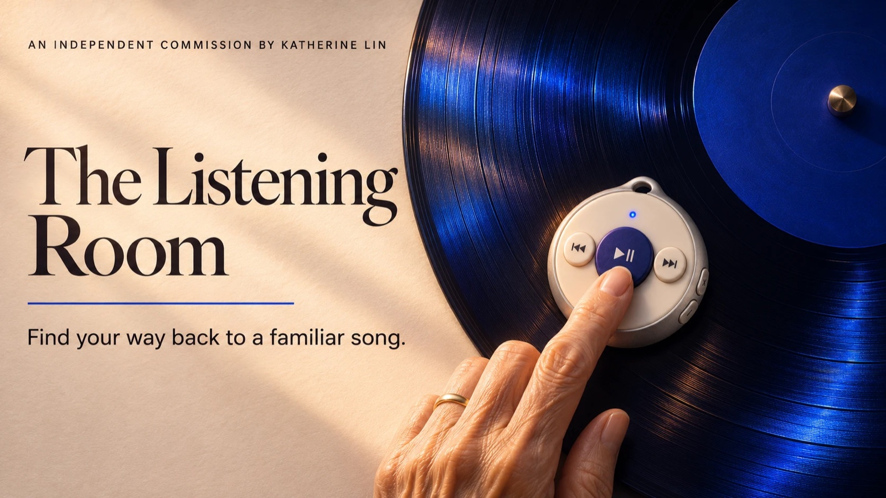

# The Listening Room

**UX and interaction design for listeners aged 65+ · Independent commission · Katherine Lin**

[Interactive prototype](https://katherine0292.github.io/the-listening-room/prototype/) · [24-screen gallery](https://katherine0292.github.io/the-listening-room/gallery/) · [Early concept](https://katherine0292.github.io/the-listening-room/early-concept/) · [Documentation index](docs/README.md)

## Summary

The Listening Room helps listeners aged 65 and over return to familiar music with less effort. It combines a simplified iOS interface, MusicTag (a tactile remote for everyday playback) and a voice search that stays recoverable when it misses.

| | |
|---|---|
| **Role** | UX and interaction design: research, interaction design, prototype, voice interaction specification, evaluation plan |
| **Audience** | Adults 65+ with varied digital confidence, vision, dexterity and language needs |
| **Context** | Spotify as the interaction context |
| **Deliverables** | High-fidelity browser prototype · 24 iOS states · early concept and hardware studies · research and design documentation |

This is a UX project. Voice search is an AI-backed feature that I specified at the interaction level. No recognition model was built or evaluated.

## Scope

| In scope | Out of scope |
|---|---|
| Desk research, interviews, synthesis | Training or tuning a recognition model |
| Information architecture and iOS interaction design | Production catalogue, invitation service, Bluetooth firmware |
| Phone and remote interaction split | Measured outcomes (pending user testing) |
| Voice search states, ranking and recovery paths | |
| High-fidelity prototype and evaluation plan | |

## From research to design

Evidence: 13 literature sources, a five-service comparison, two interviews and an early walkthrough. These give qualitative direction, not prevalence.

| Observation | Design response | Try it |
|---|---|---|
| Familiar music accompanies routines. Losing access interrupts them. | Home shows last played. Library keeps saved music. A mini-player stays in reach. | [Find a familiar song](https://katherine0292.github.io/the-listening-room/prototype/?scenario=find) |
| Mis-taps and changed controls create doubt. | Stable tabs, labelled transport controls, undo after save or remove, adjustable text and motion. | [Prototype](https://katherine0292.github.io/the-listening-room/prototype/) |
| Accents and exact-title matching make voice a barrier. | Voice is optional. Listening is visible, candidates are reviewed before playback, and retry or typing is always available. | [Recover from a voice miss](https://katherine0292.github.io/the-listening-room/prototype/?scenario=voice) |
| Daily control needs stable, marked buttons. | MusicTag has five distinct controls. The phone handles playlist choice and audio output. | [Set up MusicTag](https://katherine0292.github.io/the-listening-room/prototype/?scenario=tag) |
| Sharing helps, but links add steps. | Family playlists live in Library. Invitations state whether the recipient can listen or add songs. | [Share a family playlist](https://katherine0292.github.io/the-listening-room/prototype/?scenario=family) |

## Key decision: phone plus remote

The first proposal was a dedicated Melody Box with presets, a display, voice and a charging dock. It added a new device and a new learning path. The final concept keeps music selection on the phone and moves five repeated actions (play/pause, previous, next, volume up and down) to MusicTag. See the [design rationale](docs/design-rationale.md) for all eight decisions.

## Voice search interaction

The proposed flow has five steps: capture, recognise, match, rank, review. The system proposes candidates and the listener decides what plays.

- **Opt-in.** Listening starts only when the listener taps the microphone.
- **Visible state.** Eight states are defined, including listening, multiple matches, not understood, permission unavailable and offline.
- **Recovery.** Every failure leads to retry, typing or the library.
- **Privacy.** Default analytics record state changes and elapsed time, not raw audio or transcripts.

The [voice product specification](docs/voice-product-spec.md) covers ranking, planned language coverage (Australian English, Cantonese, Mandarin), measures and delivery sequence. The prototype uses deterministic sample inputs.

## Evaluation status

| Level | Status |
|---|---|
| Design evidence: desk research, two interviews, early walkthrough | Done |
| Browser verification: primary flows and recovery paths, desktop and 320 px | Done |
| Usability test with listeners 65+ | Planned |
| Recognition and catalogue pilot by language and accent | Planned |
| Controlled release | Planned |

The next round measures independent task completion, correct-song selection, retries, typing fallback and understanding of the phone and remote split. See the [evaluation plan](docs/evaluation.md).

## Repository

| Path | Contents |
|---|---|
| `index.html`, `assets/portfolio.*` | Portfolio page (English and Chinese) |
| `prototype/` | High-fidelity interactive prototype |
| `early-concept/` | Original three-screen flow and MusicTag simulation |
| `gallery/` | 24 iOS screens grouped into six journeys |
| `docs/` | Brief, research, rationale, voice specification, evaluation ([index](docs/README.md)) |
| `assets/screens`, `assets/archive`, `assets/art` | Screen exports, early studies, record sleeve artwork |

## Run locally

Open `index.html`, or serve the repository with `python3 -m http.server 8000`. Everything runs in the browser with local assets. In the prototype, **Restart prototype** clears saved demo preferences.

The prototype uses a small fixed catalogue and synthesised audio. Voice recognition, pairing, invitations and speaker changes are local simulations. Record sleeves, device renders and the cover use generated imagery. Icons are distributed under the [Lucide licence](assets/vendor/lucide-license.txt). This is an independent concept and is not affiliated with or endorsed by Spotify.
