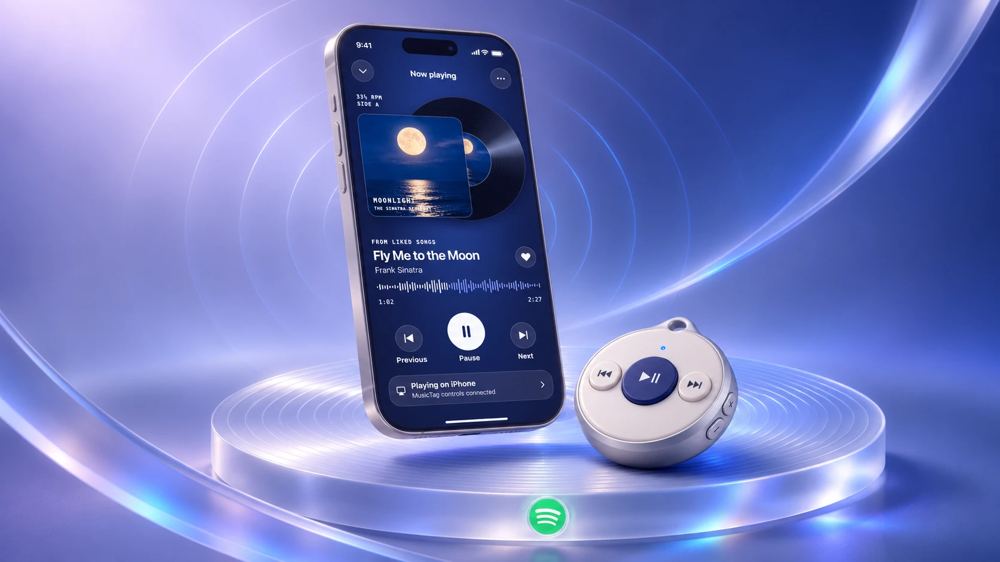

# The Listening Room

**Accessible music experience design for adults 65+ · Independent commission · Katherine Lin**

[**Portfolio page**](https://katherine0292.github.io/the-listening-room/) · [Interactive prototype](https://katherine0292.github.io/the-listening-room/prototype/) · [24-screen gallery](https://katherine0292.github.io/the-listening-room/gallery/) · [Documentation index](docs/README.md)

## Summary

The Listening Room helps listeners aged 65 and over return to familiar music with less effort. The concept pairs a simplified iOS interface with MusicTag, a tactile remote for everyday playback. Voice search is specified as an AI feature whose results the listener reviews before anything plays.

| | |
|---|---|
| **Role** | UX and interaction design: research, interaction design, prototype, voice interaction specification, evaluation plan |
| **Audience** | Adults 65+ with varied digital confidence, vision, dexterity and language needs |
| **Context** | Spotify as the interaction context |
| **Deliverables** | High-fidelity browser prototype, 24 iOS design states, early concept and hardware studies, research and design documentation |

## Scope

| In scope | Out of scope |
|---|---|
| Research and synthesis | Training or tuning the recognition model |
| Information architecture and iOS interaction design | Production catalogue, invitation service and Bluetooth firmware |
| Interaction split between phone and remote | Quantified outcomes for the prototype (pending user testing) |
| Voice search states, ranking and recovery paths | |
| High-fidelity prototype and evaluation plan | |

## Research to design

The evidence base is a desk review of 13 sources, a comparison of five music services and two first-hand interviews. Observations were coded for routine, breakdown, workaround and desired control. The interviews give qualitative direction only; they do not establish prevalence or measured effects.

| Observation | Design response | Try it |
|---|---|---|
| Familiar music accompanies routines; losing access interrupts them. | Home shows recent listening, Library keeps saved music in fixed places, and a persistent mini-player keeps playback in reach. | [Find a familiar song](https://katherine0292.github.io/the-listening-room/prototype/?scenario=find) |
| Mis-taps and changed controls create uncertainty. | Stable tabs, labelled transport controls, undo after save or remove, and adjustable text size and motion. | [Prototype](https://katherine0292.github.io/the-listening-room/prototype/) |
| Accent sensitivity and exact-title matching make voice a barrier. | Voice is optional. Listening is visible, candidates are reviewed before playing, and retry or typing is always available. | [Recover from a voice miss](https://katherine0292.github.io/the-listening-room/prototype/?scenario=voice) |
| Daily control needs to be stable and clearly marked. | MusicTag keeps play/pause, previous, next and volume on distinct physical buttons. The phone handles playlist choice and audio output. | [Set up MusicTag](https://katherine0292.github.io/the-listening-room/prototype/?scenario=tag) |
| Sharing prompts conversation, but links add steps. | Family playlists live in Library, and invitations state whether the recipient can listen or add songs. | [Share a family playlist](https://katherine0292.github.io/the-listening-room/prototype/?scenario=family) |

## Product decision

The first proposal was a dedicated Melody Box with presets, display, voice and a charging dock. It added a new device and a new learning path. The final concept reuses the phone listeners already own and moves only repeated playback actions to MusicTag. See the [design rationale](docs/design-rationale.md) for the full decision table.

## Voice search as an AI feature

The proposed flow has five steps: capture, recognise, match, rank and review. The system proposes candidates and the listener decides what plays.

- **Opt-in.** Listening starts only when the listener taps the microphone (push-to-talk).
- **Visible state.** Eight states are defined, including listening, several matches, not understood, no microphone permission and offline.
- **Recovery.** Every failure leads to retry, typing or the library.
- **Privacy.** Default analytics record state transitions and elapsed time, without raw audio or transcripts.

The [voice product specification](docs/voice-product-spec.md) covers ranking, language coverage (Australian English, Cantonese, Mandarin), measures and the delivery sequence. The prototype uses deterministic sample inputs; recognition is simulated.

## Evaluation status

| Level | Status |
|---|---|
| Design evidence: desk research, two interviews, early concept walkthrough | Done |
| Browser verification: primary flows and recovery paths on desktop and at 320 px | Done |
| Usability test with intended listeners | Planned |
| Recognition and catalogue pilot across key language conditions | Planned |
| Controlled release | Planned |

The next round measures independent task completion, correct-song selection, retries, typing fallback and understanding of the phone–remote split. See the [evaluation plan](docs/evaluation.md).

## Repository

| Path | Contents |
|---|---|
| `index.html`, `assets/portfolio.*` | Portfolio page (English and Chinese) |
| `prototype/` | High-fidelity interactive prototype |
| `early-concept/` | Original three-screen flow and MusicTag simulation |
| `gallery/` | 24 iOS screens grouped into six journeys |
| `docs/` | Brief, research, rationale, voice specification, evaluation ([index](docs/README.md)) |
| `assets/screens`, `assets/archive`, `assets/art` | Screen exports, early studies, record sleeve artwork |

## Run locally

Open `index.html`, or serve the repository with `python3 -m http.server 8000`. Everything runs in the browser with local assets. In the prototype, **Restart prototype** clears saved demo preferences.

The prototype uses a small fixed catalogue and synthesised audio. Voice recognition, pairing, invitations and speaker changes are local simulations. Record sleeves, device renders and the poster use generated imagery. Icons are distributed under the [Lucide licence](assets/vendor/lucide-license.txt).
